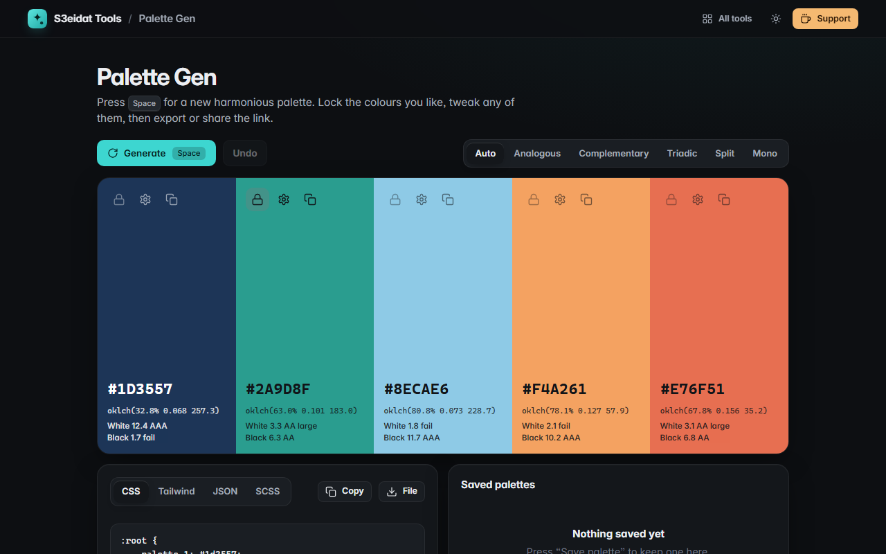

# Palette Gen

> Generate harmonious colour palettes. Free, private, and it runs entirely in your browser.

### ▶ [Open Palette Gen](https://s3eidat.github.io/palette-gen/)



## Features

- Press **Space** for a new 5-colour palette, built in **OKLCH** so lightness steps look even to the eye
- Harmonies: **analogous, complementary, triadic, split-complementary, monochrome**, or auto
- **Lock** colours you like; new palettes keep them and build around the first locked hue
- **Edit** any colour with a picker or by typing a hex; **undo** with the button or Ctrl+Z
- Every swatch shows its hex, OKLCH value and **WCAG contrast** against white and black (AAA / AA / AA large / fail)
- Export as **CSS variables, Tailwind config, JSON (hex, RGB, OKLCH) or SCSS**, copy or download
- Download the palette as a **PNG**
- **Share by link**: the palette lives in the URL hash (`#264653-2a9d8f-…`)
- **Save palettes** in this browser and load them with one click

Colours that fall outside sRGB are brought back in by lowering chroma while keeping lightness and hue.

## Privacy

Everything happens on your device. Saved palettes are stored in your browser's local storage; the share link
keeps the colours after `#`, which browsers never send to a server. There is no account and no analytics.
The page ships with a strict Content-Security-Policy (`connect-src 'self'`), so the browser itself blocks any
attempt to send data anywhere.

## Run it yourself

It's plain HTML, CSS and JavaScript with no build step:

```bash
git clone https://github.com/s3eidat/palette-gen
cd palette-gen
python -m http.server 8000
```

Then open http://localhost:8000.

## Support

If this saved you time, **[buy me a coffee ☕](https://s3eidat.github.io/coffee/)**. It keeps every tool free.

---

Part of **[S3eidat Tools](https://s3eidat.github.io/)**: 100+ free, private tools that run in your browser. MIT licensed.
